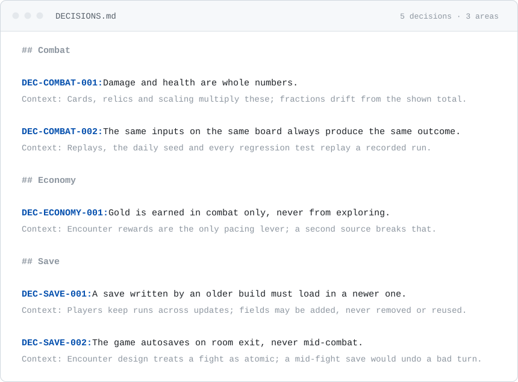

# decisions-md

Agents can forget design decisions. They sometimes re-open a settled question, or
contradict a choice you already made.

`DECISIONS.md` is a plain file with one binding decision per entry. This plugin reads
it, works out which decisions govern the file Claude is about to edit, and puts those
decisions in front of Claude at that moment.

Standard library Python, no third-party packages, no companion tooling. Its own state
never touches your repository.

## Install

```
/plugin marketplace add github.com/bitbutter/decisions-md
/plugin install decisions-md
```

This repo is its own marketplace. Restart or reload Claude Code afterwards so the hooks
register.

You need a Python 3 reachable as `python3`, `python` or `py` — each hook picks the first
that resolves, so one manifest works on macOS, Linux and Windows.

Until a project has a `DECISIONS.md`, every hook exits without doing anything. You can
install now and write the file later. There is no per-project setup: no gitignore entry,
no config file, nothing to copy in.

## The file

`DECISIONS.md` goes at your project root, or in `docs/`, `support/`, `design/` or
`decisions/`. A decision is one line:

```
DEC-ECONOMY-001: Gold is earned in combat only, never from exploring.
```

An ID, a colon, and the rule. The statement can wrap across lines. Add a `Context:` line
underneath when the reasoning is worth keeping:

```
DEC-ECONOMY-001: Gold is earned in combat only, never from exploring.
Context: Encounter rewards are the only pacing lever; a second source breaks that.
```

`DEC-<AREA>-<NNN>`. Areas are yours to name — INPUT, RENDER, ECONOMY, whatever parts
your project has. The plugin only uses them for grouping.

A whole file looks like this:

<picture>
  <source media="(prefers-color-scheme: dark)" srcset="docs/decisions-example-dark.svg">
  
</picture>

The `## Combat` headings are ordinary markdown for your own reading. The plugin takes the
area from the ID, so headings are optional and it does not matter what you call them.

There is no status line and no status vocabulary. Every entry in the file is binding.

Check the format at any time with `/decisions-md:decisions --lint`.

## What belongs in the file

Two questions decide it, and both answers have to be yes.

**1. Could someone violate this without anything failing?**

Do the opposite in your head. Does it compile, pass the tests and run? If a type, an
assert or a test would catch it, that mechanism is already holding the rule. Leave it
there. A rule written in two places goes stale in one of them, and the file is the copy
nobody re-checks.

**2. Does it bind work that has not been written yet?**

Try naming everything that has to obey it. If you can finish the list, this is a refactor
— go and change those places. If the honest answer is "anything that ever grants gold",
it is a decision.

That second question is what separates a decision from a setting. Rebind jump to B and you
can name what changes: the input map, the button prompt art. Nothing else owes the old
binding anything. A rule against a second source of gold is owed by every reward anyone
will ever write.

### Most of this gets decided early

Most of what belongs in this file gets settled early. What the player is promised, what a
save has to guarantee, what may never happen during a fight — those are usually decided
before the code that depends on them exists, which is exactly why they end up constraining
so much of what comes later. A choice made in week one rules out an approach in month six.

Early is also when a decision is easiest to lose. It gets made in conversation, acted on
once, and after that it lives in whoever remembers it. Nothing in the code states it, so
nothing contradicts an agent that assumes otherwise and writes something reasonable that
quietly violates it.

That is the entire job of the file: hold the handful of choices that later work has to fit
around, and put them back in front of whoever is about to write that work. Everything the
code can already answer belongs in the code.

### Changing a decision

Edit it in place and keep its ID. Put the reason in the commit message.

Do not append a second entry that overrides the first, and do not keep a revision log
inside the entry. The file states what is true now; `git log -p DECISIONS.md` states
what used to be true, with a date, an author and a message.

Keep the ID the same. Code comments refer to these IDs, and a comment pointing at
`DEC-INPUT-001` should take you to the rule that applies now.

### Retiring a decision

Delete it.

If "we considered X and rejected it" still matters, that is a live rule, not a retired
one — so write it down as a rule. Otherwise the question really is open again, and there
is nothing wrong with an agent raising it.

## How it behaves

**Before an edit.** When Claude is about to write to a source file, the plugin works out
which decision areas govern that path and prints those decisions:

```
[DECISIONS] 2 binding decisions govern src/input/player.gd (area: input).
Read them, then re-run your edit. Nothing else is required to proceed.

DEC-INPUT-001: Jumping is bound to the A button.
DEC-INPUT-002: Holding the jump button does not increase jump height.

If one of these contradicts the change you are about to make, stop and offer the user:
abandon / adapt / override. Otherwise just carry on.
```

Claude reads that, runs the edit again, and it goes through. This happens once per area
per session: move from input code to render code and you get the render decisions. If
no decision applies to a file, nothing is shown and nothing is interrupted.

**Reading them yourself.**

```
/decisions-md:decisions                      # areas and how many decisions each holds
/decisions-md:decisions --query jump input   # search; multi-word needs no quotes
/decisions-md:decisions --area input         # one area in full, with the reasoning
```

**When Claude stops.** If the session edited files in an area you have no decisions
about yet, the Stop hook asks once whether anything that changed should be written down.
It does not ask when you already have decisions covering those files. The question is
worded so that "nothing to add" is the normal answer.

**Through compaction.** When a long conversation gets compacted, the short summary of
your decisions is sent again, so it is not lost.

## Keeping the file small

`--lint` checks the format, and warns about things that make the file harder to use:

- an entry longer than about eight lines, or a rule stated in more than 120 words — at
  that length an entry usually contains more than one rule
- two entries that say nearly the same thing
- a file name, function call or variable name in a statement — those are better off in
  a code comment that cites the decision
- an area with more than about 25 decisions in it

Errors mean the file will not be read correctly. Warnings are suggestions, and never
block anything.

## Migrating from 1.x

The old format had `Status:` lines and override-suffix IDs like `DEC-INPUT-007d`. Both
are gone.

```
/decisions-md:decisions --lint --write   # deletes the plain Status lines for you
/decisions-md:decisions --lint           # lists what is left
```

`--write` only deletes `Status:` lines that say nothing more than `Active` and a date.
Three things are left for you to decide:

- **a `Status:` line with extra text in it** — move anything still true into the
  statement above it, then delete the line
- **an override-suffix entry** like `DEC-INPUT-007d` — work its rule into the entry it
  overrides, then delete it
- **a retired entry** — delete it

## Limitations

Worth knowing before you rely on it.

**It guesses which decisions apply to a file.** It checks three things, in order: a
pattern you set yourself in `area_map`; whether an area's name appears in the file's
path; and how many words the file's path and a decision have in common. It can still
guess wrong, in both directions. If a decision governs files whose names give no clue,
pin them with `area_map`.

**Showing Claude a decision does not force it to follow one.** A hook can stop a tool
call, but it cannot make a model obey a rule it has just read. This makes Claude much
more likely to follow your decisions. It cannot guarantee it.

**It only sees Claude's Write and Edit tools.** If Claude changes a file by running a
shell command instead — `sed`, a heredoc, `python -c` — the plugin does not notice. Nor
does it notice edits you make in your own editor, which is harmless: nothing it does
depends on seeing those.

**The Stop check runs at most once per session**, and only for files in areas that have
no decisions yet. If a session settles a second rule in an area that already has some,
you will not be asked about it.

**It uses some of Claude's context.** A short summary at the start of a session and
again after compaction, plus the decisions for each area you touch — just the one-line
statements, not the reasoning. Nothing is added to every prompt.

## Configuration

Optional. Drop `<project>/.decisions/config.json` — this file belongs to your project
and should be committed.

```json
{
  "tracked_extensions": [".py", ".ts", ".rs"],
  "exempt_paths": ["DECISIONS.md", ".decisions/", ".claude/", "tools/"],
  "area_map": { "src/rendering/**": "render", "shaders/**": "render" },
  "enabled": true
}
```

`tracked_extensions` — which file types cause decisions to be shown. The default covers
Godot (`.gd`, `.tscn`, `.tres`, `.gdshader`, `.gdextension`) and common script types
(`.py`, `.js`, `.jsx`, `.mjs`, `.cjs`, `.ts`, `.tsx`, `.rb`, `.go`, `.rs`, `.lua`,
`.sh`, `.ps1`). Set it to `[]` to stop showing decisions before edits, while leaving the
Stop check running.

`exempt_paths` — folders, relative to your project root, that never cause decisions to
be shown. These match from the start of the path, so `tools/` covers `tools/build.py`
but not `src/tools/thing.py`. Setting this replaces the whole default list, which is
`DECISIONS.md`, `.decisions/`, `.claude/`, `tools/`, and the usual folders holding code
you did not write: `addons/`, `vendor/`, `third_party/`, `node_modules/`, `.godot/`,
`build/`, `dist/`.

`area_map` — matches file patterns to an area, for files whose names give no clue which
area they belong to. A single `*` does not cross a `/`; `**` does.

`enabled: false` — turns the whole plugin off for this project.

## What runs when

| Component | Event | Behaviour |
|-----------|-------|-----------|
| `decisions_session_start.py` | SessionStart | Persists the session id, clears last session's bookkeeping, injects the orientation block. |
| `decisions_serve.py` | PreToolUse `Write\|Edit` | Serves the decisions governing the target file, once per area per session. |
| `decisions_check.py` | PostToolUse `Write\|Edit` | Records edited files; lints DECISIONS.md when it is written. |
| `decisions_precompact.py` | PreCompact | Carries the orientation block through compaction. |
| `decisions_stop_check.py` | Stop | Asks once about work in areas no decision covers. |
| `commands/decisions.md` | `/decisions-md:decisions` | The read and lint command. |
| `skills/decisions-binding/` | skill | The entry format and the abandon/adapt/override protocol. |
| `scripts/query_decisions.py` | | The CLI behind the command. |

## State

Kept in `~/.claude/decisions-md-state/<project>/`, never in your project. It holds which
areas Claude has already been shown this session, which files were edited, and the
current session id. You can delete it safely — the only effect is that Claude gets shown
a list of decisions it had already seen.

`DECISIONS_STATE_DIR` moves that folder somewhere else.

If you used 1.x, it left a `.decisions/cache/` directory in each project. Nothing reads
it any more; `--doctor` will point at it and you can delete it, along with the
`.decisions/` line in your `.gitignore`. Keep `.decisions/config.json` if you have one.

## When it seems inert

```
/decisions-md:decisions --doctor
```

It reports which Python is actually running, which folder it decided is your project,
whether it found a `DECISIONS.md`, whether it can write its state folder, and whether
the hooks have run at all. If it says the session id is missing, no hook is starting —
nearly always because none of `python3`, `python` or `py` is on your PATH.

Claude Code runs hooks through a POSIX shell on every platform. On Windows that is Git
Bash, not `cmd`, which is why one command string works everywhere.

## Local install

To run a clone directly:

```
/plugin marketplace add /absolute/path/to/decisions-md
/plugin install decisions-md
```

## Tests

```
python tests/verify_plugin.py        # feeds each hook fake input, checks what it does
python tests/verify_hook_launch.py   # checks the hooks can start at all on this machine
```

The first one runs the hook scripts directly, so it cannot tell you whether Claude Code
is able to start them. That gap once hid a bug that stopped the plugin working on
Windows completely, while the tests still passed.

## License

MIT. See [LICENSE](LICENSE).
